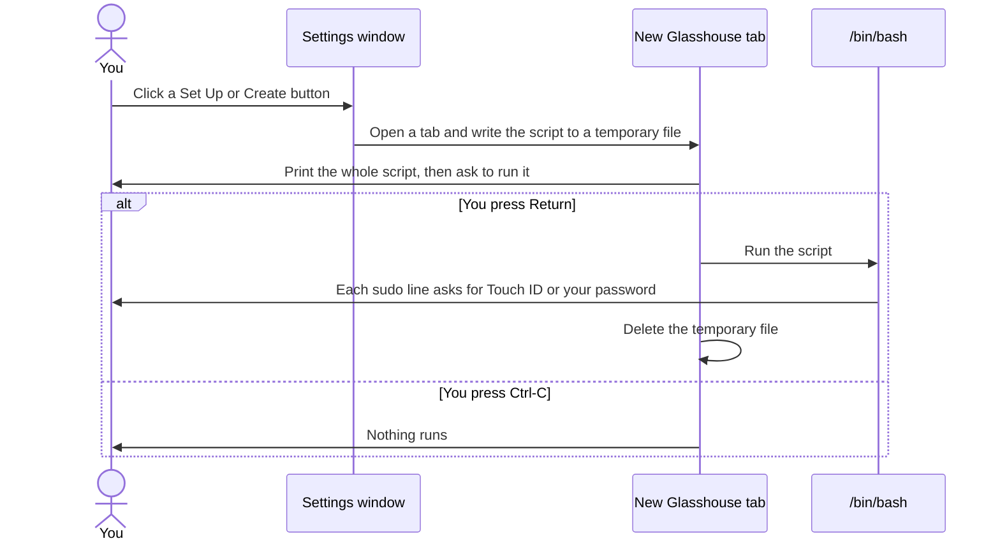
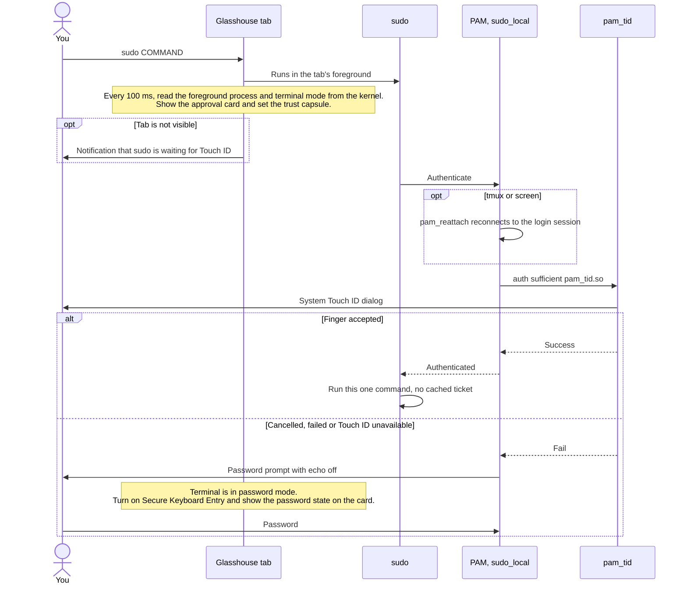
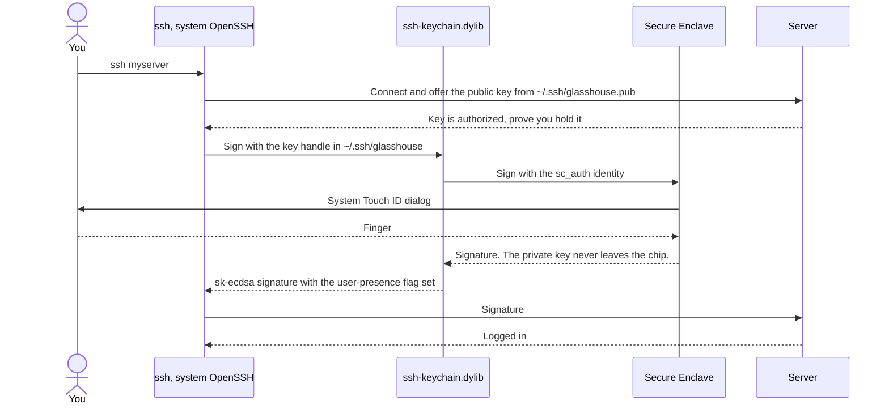
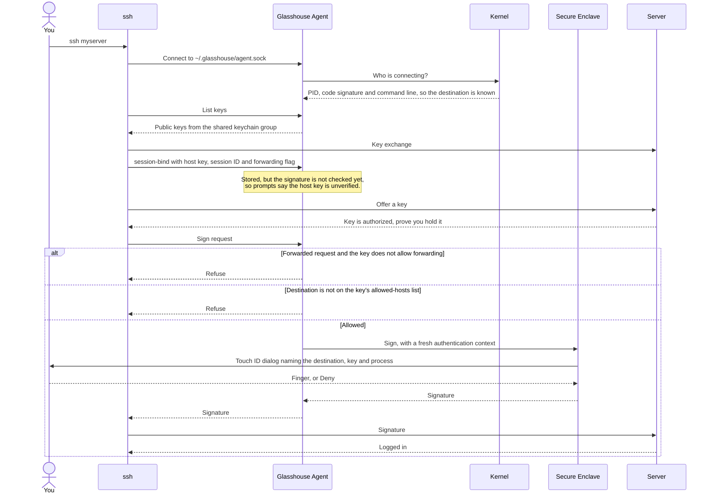
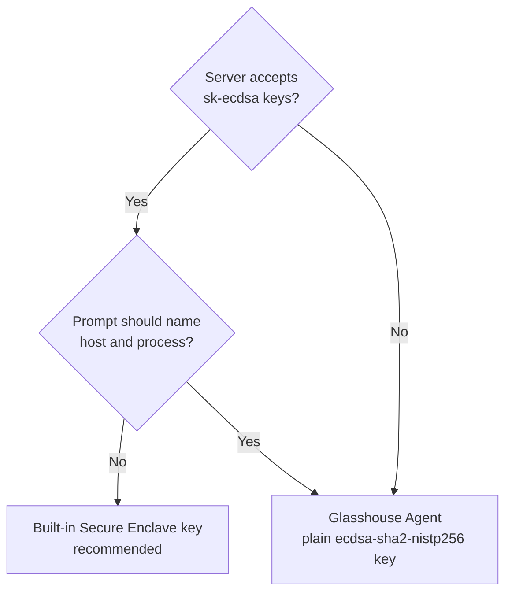

# Glasshouse

A native macOS terminal (Swift 6, macOS Tahoe 26+) that keeps Terminal.app's strengths — VoiceOver, prompt marks,
Secure Keyboard Entry, low memory — and fixes its weaknesses: invisible features, no command awareness, no command palette, and
no trust signals around `sudo` and SSH. Liquid Glass is used **only on controls**; the terminal grid is opaque content.

> **Status: scaffold.** Architecture, security plumbing, shell integration and UI structure are in place.
> It was written without a Mac toolchain available, so expect a round of compile fixes. Items to check first are listed
> under [Verify first](#verify-first).

## Build

```sh
brew install xcodegen
xcodegen generate              # → Glasshouse.xcodeproj (app + embedded agent login item)
open Glasshouse.xcodeproj      # set DEVELOPMENT_TEAM in project.yml first (needed for Secure Enclave keychain access)
swift test                     # wire-protocol, OSC parser and APCA tests (no UI, no signing needed)
```

Edit `project.yml`, not the generated project: `xcodegen generate` overwrites `Glasshouse.xcodeproj`, so changes made in
Xcode's project editor (build settings, files dragged into the navigator) are lost on the next run. Files placed under
`Apps/Glasshouse/` are picked up automatically.

Distribution: Developer ID + hardened runtime + notarization. **Not sandboxed, not Mac App Store**: a sandboxed terminal's
child shells inherit the sandbox.

## App icon

`Apps/Glasshouse/GlasshouseIcons.xcassets` holds three candidate icons. Each set has all ten macOS sizes. The 16 and 32 pt
sizes are simplified drawings so they stay readable, and every image follows Apple's macOS grid: an 824 px body centred
on a 1024 px canvas with a transparent margin.

| Set | Name |
|---|---|
| `AppIconA` (default) | Pane |
| `AppIconB` | Print Prompt |
| `AppIconC` | Glasshouse |

**Switch icons:** change `ASSETCATALOG_COMPILER_APPICON_NAME` under the `Glasshouse` target in `project.yml`, then run
`xcodegen generate` and build. To try one without editing anything, override the setting for a single build:

```sh
xcodebuild -project Glasshouse.xcodeproj -scheme Glasshouse ASSETCATALOG_COMPILER_APPICON_NAME=AppIconB build
```

**If the Dock or Finder still shows the old icon** (macOS caches icons aggressively):

1. Clean the build folder (⇧⌘K) and delete the app from DerivedData.
2. Run `killall Dock`.
3. If Finder is still stale, `touch` the built `Glasshouse.app`.

**Liquid Glass on macOS 26:** these PNG sets work on Tahoe, but Tahoe draws the full Liquid Glass treatment (specular
edges, tinted and clear modes) only from an Icon Composer `.icon` file. Once an icon is chosen:

1. Open that set's `icon_512x512@2x.png` (the 1024 px master) in Icon Composer.
2. Split it into layers: background, glyph and glass pane.
3. Save the `.icon` file in `Apps/Glasshouse/`.
4. Set `ASSETCATALOG_COMPILER_APPICON_NAME` to the `.icon` file's name, without the extension.
5. Regenerate, and check in Xcode that the `.icon` file is in the target's Copy Bundle Resources phase.
6. Delete the PNG sets you no longer need.

## Layout

```
Package.swift                    GlasshouseKit — UI-free libraries
Sources/
  TerminalCore/                  TerminalEngine protocol, SwiftTerm 1.x adapter, PTY env, termios password detection
  ShellIntegration/              OSC 133/7/9/777 scanner, CommandTimeline, zsh/bash/fish injection (no dotfile edits)
  GlasshouseSecurity/            Foreground-process inspection, Secure Keyboard Entry, Touch ID sudo + native SE SSH setup
  SSHAgentCore/                  RFC 9987 agent: wire format, Secure Enclave key store, BSD-socket server, peer identity
  DesignSystem/                  glassChrome() + accessible fallbacks, APCA contrast floor, TrustCapsule, tokens
Apps/
  Glasshouse/                    SwiftUI app: workspace, tabs, pane overlays, palette, approval card, settings
    GlasshouseIcons.xcassets/    app icon candidates AppIconA/B/C (see App icon)
  GlasshouseAgent/               LSUIElement login item serving Secure Enclave keys (opt-in)
Tests/                           swift-testing suites
project.yml                      XcodeGen spec (bundle layout, entitlements, signing)
```

## SwiftTerm versions

| SwiftTerm | How to build | How the adapter gets output, OSC sequences and geometry |
|---|---|---|
| **1.99.1** (default; preview of 2.0) | nothing extra | `observeOscEvents`, `setProcessOutputHandler`, `terminalContentSnapshot(region:)` |
| **1.20.x** (legacy) | point `Package.swift` at upstream 1.20.x and enable the `SwiftTerm1` trait | overrides `dataReceived(slice:)` and reads `getTerminal().buffer` |

The default build uses [a fork](https://github.com/jasonkolodziej/SwiftTerm/tree/fix/teardown-qos-1.99.1): 1.99.1
plus one fix that runs process teardown at the I/O threads' priority, so closing a tab doesn't cause a priority inversion.
The fix has been sent upstream; switch back to `migueldeicaza/SwiftTerm` once a release includes it.

1.99 rebuilt SwiftTerm's input/output pipeline, so its API changed:

- `getTerminal()` and the public `terminal` property are gone.
- Output now goes to an internal adapter. `dataReceived(slice:)` can still be overridden, but it is **never called**, so an override would compile and silently do nothing.

## Layer model

| Layer | What | Material |
| --- | --- | --- |
| L1 content | terminal grid, command gutter, sticky header | **opaque** (translucency is opt-in, Regular glass only, forced off by Reduce Transparency / Increase Contrast) |
| L2 controls | toolbar + tab strip, sidebar, find bar | system Liquid Glass |
| L3 transient | command palette, Touch ID approval card | glass + dimming via `glassChrome(.transient)` |
| L4 trusted | TrustCapsule, card header | filled capsule; driven **only** by kernel state (termios, process table) |

## Touch ID and SSH

Glasshouse ships no PAM module, no privileged helper and no code in the default SSH signing path. Touch ID for `sudo`
and the default SSH keys use Apple's own components. Glasshouse sets them up in a visible tab and shows trusted status
around them. The optional Glasshouse Agent is the only Glasshouse code that signs anything.

| | Touch ID for `sudo` | SSH: built-in key (recommended) | SSH: Glasshouse Agent (optional) |
| --- | --- | --- | --- |
| What shows the Touch ID prompt | `pam_tid` (system dialog) | `/usr/lib/ssh-keychain.dylib` (system dialog) | Glasshouse Agent; the prompt names the host, key and process |
| Glasshouse code in the authentication path | none | none | the agent |
| Needs `DEVELOPMENT_TEAM` | no | no | yes |
| State | ready to try | ready to try | partial, see [Known gaps](#known-gaps) |

None of this has been run on a Mac yet. Treat the first run as a test, and see [Verify first](#verify-first).

### Before you start

- A Mac with Touch ID, or a Magic Keyboard with Touch ID, running macOS 26.
- Build and run Glasshouse, then open **Glasshouse › Settings** (⌘,).
- Click into a terminal tab at least once first. Setup buttons open their script in the most recently focused window,
  and do nothing if no window has been focused yet.
- **Glasshouse Agent only:** set `DEVELOPMENT_TEAM` in `project.yml` to your Team ID, then run `xcodegen generate` and
  rebuild. The agent keeps its keys in a shared keychain group (`keychain-access-groups`), a restricted entitlement
  that needs a provisioning profile. Without one, keychain calls fail with error -34018.

### How setup scripts run

Glasshouse never edits system files itself. Each **Set Up** or **Create** button writes its script to a temporary file
and opens a new tab. The tab prints the whole script and waits for you.



### Touch ID for `sudo`

**Set up:**

1. Open **Settings › Security**.
2. If you use tmux or screen, tick **I use tmux or screen**. Touch ID can't reach the screen from inside those
   programs without `pam_reattach`.
3. Click **Set Up in New Tab…**, read the script, and press Return. The script:
   1. runs `sudo -v` once, so you authenticate up front;
   2. with the tmux option, installs `pam-reattach` with Homebrew and copies it, owned by root and read-only, to
      `/usr/local/lib/pam/pam_reattach.so`;
   3. writes `/etc/pam.d/sudo_local` (root:wheel, mode 0444) with `auth sufficient pam_tid.so`. `sudo_local` survives
      macOS updates, and `sufficient` keeps your password as the fallback;
   4. writes `/etc/sudoers.d/10-glasshouse-touchid` with `Defaults timestamp_timeout=0`, so each Touch ID tap
      approves exactly one command;
   5. checks the sudoers syntax with `visudo -c`;
   6. runs `sudo -k && sudo true` as a test. This should ask for Touch ID.
4. Expect several Touch ID prompts near the end: once the one-command rule exists, each remaining `sudo` line asks
   again.
5. Click **Refresh**. **pam_tid in sudo_local** should read **Enabled**.

**Check it:** run `sudo -k; sudo true` in any tab. You should get the system Touch ID dialog, and Glasshouse should show
its approval card.

**Undo:** **Roll Back…** removes `/etc/pam.d/sudo_local` and `/etc/sudoers.d/10-glasshouse-touchid`. It leaves the
`pam_reattach.so` copy in `/usr/local/lib/pam`; delete that with `sudo rm` if you no longer need it.

**What Glasshouse shows while `sudo` waits:** while `sudo` is the tab's foreground process, Glasshouse checks the
kernel every 100 ms. The approval card names the command, the target user, the host and the tab. When the terminal
switches to password mode (echo off), the card changes to "Password requested" and Secure Keyboard Entry turns on. If
the tab isn't visible, Glasshouse posts a notification instead. None of this is in the authentication path: it reads
state, and `sudo` and PAM make every decision.



### SSH, option 1: built-in Secure Enclave key (recommended)

Apple's `sc_auth` creates a P-256 key inside the Secure Enclave. The key can't be exported and needs Touch ID for every
use. OpenSSH reaches it through `/usr/lib/ssh-keychain.dylib` as an `sk-ecdsa-sha2-nistp256@openssh.com` key.

**Set up:**

1. Open **Settings › SSH Keys**. **Secure Enclave provider** should read **Available**.
2. Click **Create Secure Enclave Key in New Tab…** and press Return. The script:
   1. runs `sc_auth create-ctk-identity -l glasshouse -k p-256-ne -t bio`, which asks for Touch ID;
   2. runs `ssh-keygen -w /usr/lib/ssh-keychain.dylib -K -N ""` in a temporary folder to download the key *handle*,
      which contains no secret. If it asks for a PIN, press Return;
   3. moves the handle to `~/.ssh/glasshouse` and `~/.ssh/glasshouse.pub` (mode 0600) and prints the public key.
3. Add the public key to the server's `~/.ssh/authorized_keys`, or to GitHub or GitLab as an SSH key. Servers need
   OpenSSH 8.2 or later.
4. Add the host to `~/.ssh/config`:

   ```
   Host myserver
       HostName myserver.example.com
       User you
       IdentityFile ~/.ssh/glasshouse
       SecurityKeyProvider /usr/lib/ssh-keychain.dylib
       IdentitiesOnly yes
       ForwardAgent no
   ```

   Glasshouse tabs already set `SSH_SK_PROVIDER`, so `ssh` inside Glasshouse finds the provider without the
   `SecurityKeyProvider` line. The line makes the key work from other terminals and from Git.
5. Test with `ssh myserver`, or `ssh -T git@github.com`. You should get one system Touch ID dialog.
6. Register a second key, from another Mac or a hardware security key, as a backup. Secure Enclave keys can't be
   backed up, so losing this Mac means losing this key.

**Notes:**

- The button always names the key `glasshouse`. To make a second key on the same Mac, rename the existing
  `~/.ssh/glasshouse` files first.
- To list or remove Secure Enclave identities, see `man sc_auth` (`list-ctk-identities`, `delete-ctk-identity`).



### SSH, option 2: Glasshouse Agent (optional)

A login item with no Dock icon that serves its own Secure Enclave keys over an ssh-agent socket at
`~/.glasshouse/agent.sock`. Use it when you want the Touch ID prompt to name the destination, the key and the
requesting process, or when a server rejects `sk-` keys: the agent's keys are plain `ecdsa-sha2-nistp256`. Hosts opt in
one at a time with `IdentityAgent`. Glasshouse never sets `SSH_AUTH_SOCK` globally.

**Set up:**

1. Set `DEVELOPMENT_TEAM` (see [Before you start](#before-you-start)), regenerate and rebuild.
2. Open **Settings › SSH Keys** and turn on **Run Glasshouse Agent at login**. If **Approve in System Settings…**
   appears, click it and turn on Glasshouse Agent under **General › Login Items**.
3. Enter a comment, choose whether to tick **Strict**, and click **New Key**.
   - **Strict:** only Touch ID with the fingers enrolled now. Enrolling a new finger makes the key unusable.
   - **Not strict:** Touch ID, Apple Watch or your login password.
4. Click **Copy Public Key** and add it to the server.
5. Point the host at the agent in `~/.ssh/config`:

   ```
   Host myserver
       HostName myserver.example.com
       User you
       IdentityAgent "~/.glasshouse/agent.sock"
       IdentitiesOnly yes
       ForwardAgent no
   ```

6. Test with `ssh myserver`. The Touch ID prompt should read something like "sign in to you@myserver with key
   “you@mac” for ssh [pid 1234]".

**What the agent checks before each signature:**

- It identifies the connecting process from the kernel (its PID, code signature and command line).
- It refuses a request that arrives through agent forwarding unless the key allows forwarding.
- It refuses a destination that isn't on the key's allowed-hosts list, when that list isn't empty.
- It asks for Touch ID with a fresh authentication context every time, so no approval is cached.



### Which SSH option?

`sk-ecdsa` keys need OpenSSH 8.2 or later on the server. GitHub and GitLab accept them.



### Known gaps

- **Agent host keys:** the agent stores each `session-bind` but doesn't verify its signature yet, so every prompt
  says "host key unverified".
- **Agent rules:** the agent enforces allowed hosts and forwarding per key, but Settings has no controls for them. New
  keys accept any destination and refuse forwarded requests.
- **Agent key deletion:** deleting a key has no confirmation, and can't be undone.
- **Built-in key:** the key name is fixed at `glasshouse`, and there's no button to add the `~/.ssh/config` block.

### Troubleshooting

| Symptom | Likely cause and fix |
| --- | --- |
| A setup button does nothing | No Glasshouse window has been focused yet. Click into a terminal tab, then try again. |
| Status still reads "Not set up" after setup | Click **Refresh**. Check with `cat /etc/pam.d/sudo_local`. |
| Orange warning about `pam_reattach` | `sudo_local` loads `pam_reattach` from a user-writable path such as `/opt/homebrew`, which lets any process running as you gain root. Re-run setup with the tmux option ticked. |
| Touch ID works, but not inside tmux | Tick the tmux option and re-run setup. |
| `sudo` asks for your password | Expected when Touch ID is unavailable, for example over SSH into this Mac or with the lid closed and no Touch ID keyboard. |
| **Secure Enclave provider** reads "Not found" | `/usr/lib/ssh-keychain.dylib` or `sc_auth` is missing. They need macOS 26. |
| Server rejects the built-in key | The server runs OpenSSH older than 8.2, or its `PubkeyAcceptedAlgorithms` leaves out `sk-ecdsa-sha2-nistp256@openssh.com`. Use the Glasshouse Agent's plain ECDSA key instead. |
| Agent errors mentioning -34018 | The app isn't signed with your Team ID. Set `DEVELOPMENT_TEAM`, regenerate and rebuild. |
| **Run Glasshouse Agent at login** turns itself off | Approve it under **System Settings › General › Login Items**. |

## Design critique → code

| Critique item | Where it landed |
| --- | --- |
| U1 ⌘K collision | `GlasshouseCommands`: ⌘K = clear (Terminal.app), hosts = ⇧⌘O, palette = ⇧⌘P |
| U2 card placement | `TerminalPane`: card anchored bottom, by the cursor, with a "Waiting for Touch ID…" phase |
| U3 hidden pane | `Notifier.approvalWaiting` when the pane isn't visible and key |
| U4 sticky header occlusion | shown only when the viewport is scrolled above the cursor row; never in the alternate screen |
| U5 gutter over text | 12 pt reserved inset (`GH.Size.gutterWidth`), 16 pt hit areas, hover popover |
| U6 sidebar default | collapsed; ⌃⌘S |
| U7 focus theft | VoiceOver announcement, no focus move |
| One trust signal | `TrustCapsule` — 3 states, filled + tinted; tab titles plain, sanitised |
| Contrast floor | `ContrastPolicy.standard` = Lc 75 / 60; Increase Contrast = 90 / 75 |

## Verify first

These were not checked against source or on a Mac. Each one is a quick prototype, worth doing before any UI polish.

1. **SwiftTerm version.** The adapter was checked against SwiftTerm's source at tags v1.20.0 and v1.99.1, but it hasn't been compiled. Default builds use **1.99.1** (from the fork above). To build against 1.20.x, point `Package.swift` at upstream 1.20.x and enable the `SwiftTerm1` trait. **1.99.0 is not supported.** Two things to watch:
   - SwiftTerm 1.99 is a preview of 2.0, so later 1.99.x releases may change its API again.
   - On 1.20, the cursor row is only accurate while the view is scrolled to the bottom (`yBase` isn't public), and `getText`'s row coordinates still need checking.
2. **`KERN_PROCARGS2` on setuid-root `sudo`.** If the kernel refuses it, the card falls back to the shell-reported command and labels it "reported by shell".
3. **Reading the PTY master on macOS**: termios (`tcgetattr`) must show the slave side's ECHO/ICANON state, and `tcgetpgrp` must return the slave's foreground process group.
4. **`LOCAL_PEERTOKEN` = 0x006 and `SOL_LOCAL` = 0** in the macOS 26 SDK (`PeerIdentity.swift`).
5. **macOS 26 SwiftUI APIs used:** `ToolbarSpacer` and `sharedBackgroundVisibility`, and `Glass.regular.tint(_:)`.
6. **Native SE SSH quirks:** `ssh-keygen -K` prompts for a PIN (leave it blank); duplicate stub file names when you have several keys (FB21992630).

## Helpful Commands

### SSH Version Check

> [!NOTE]
> The version that matters is the server's (`sshd`): the built-in Secure Enclave key needs OpenSSH 8.2 or later on the server.

**On the Ubuntu machine itself:**

- **Client (`ssh`):** `ssh -V`. This prints something like `OpenSSH_9.6p1 Ubuntu-3ubuntu13.5, OpenSSL 3.0.13 30 Jan 2024`, written to stderr.
- **Server (`sshd`):**

  ```sh
  dpkg -l openssh-server | tail -1
  ```

  `apt policy openssh-server` also works and shows the installed and available versions. On newer releases, `sudo sshd -V` prints the version directly.

**From your Mac, without logging in:**

```sh
ssh -v myserver 2>&1 | grep "remote software version"
# debug1: Remote protocol version 2.0, remote software version OpenSSH_9.6p1 Ubuntu-3ubuntu13.5
```

`nc myserver 22` also works: it prints the server's version banner straight away. Press Ctrl-C to close it.

Any Ubuntu release from 20.04 on ships OpenSSH 8.2 or later, so it accepts `sk-ecdsa` keys.

### SHA of Public Key

```bash
ssh-keygen -lf ~/.ssh/glasshouse.pub
# 256 SHA256:Xb3k…qY0 you@mac (ECDSA-SK)
```

### SSH Key Installation

You install the **public** key in the server's `~/.ssh/authorized_keys`. The private key stays in the Secure Enclave, so there's nothing secret to copy.

#### Copy the public key to the server

The usual way, from your Mac:

> [!TIP]
> If it asks for Touch ID or errors on the new key while checking whether it's already installed, add `-f` to skip that check:

```sh
ssh-copy-id -i ~/.ssh/glasshouse.pub you@server

# skip check
ssh-copy-id -f -i ~/.ssh/glasshouse.pub you@server
```

This logs in the way you do today (password or an existing key) and appends the public key to `~/.ssh/authorized_keys` on the server.

#### By hand

If you'd rather do it by hand, this has the same effect and also sets the permissions `sshd` requires:

```sh
cat ~/.ssh/glasshouse.pub | ssh you@server \
  'mkdir -p ~/.ssh && chmod 700 ~/.ssh && cat >> ~/.ssh/authorized_keys && chmod 600 ~/.ssh/authorized_keys'
```

If you have no login on the server yet, paste the contents of `glasshouse.pub` as one line at the end of `~/.ssh/authorized_keys` through whatever access you do have: a console, cloud-init, or your provider's control panel.

#### Test it before relying on it

```sh
ssh -i ~/.ssh/glasshouse -o IdentitiesOnly=yes \
    -o SecurityKeyProvider=/usr/lib/ssh-keychain.dylib you@server
```

You should get one Touch ID prompt and then a shell. Inside a Glasshouse tab you can leave out the `SecurityKeyProvider` option, because Glasshouse already sets it in its tabs.

**3. Make it permanent:** add the host block to `~/.ssh/config` (it's in the README under "SSH, option 1"), and from then on `ssh myserver` is enough.

**Notes:**

- **The server** needs OpenSSH 8.2 or later; any Ubuntu from 20.04 on is fine. No `sshd_config` changes are needed, because `sk-ecdsa` keys are allowed by default.
- **Recovery:** install a second key, from another Mac or a hardware key, before turning off password login on the server. A Secure Enclave key can't be recovered if you lose this Mac.
- **GitHub or GitLab:** there's no file to edit. Go to **Settings › SSH and GPG keys › New SSH key**, choose the type **Authentication Key**, and paste the contents of `glasshouse.pub`. Test it with `ssh -T git@github.com`.
- **A Glasshouse Agent key** goes on the server the same way. Click **Copy Public Key** in Settings, then run `pbpaste | ssh you@server 'cat >> ~/.ssh/authorized_keys'`.

## Not yet built (TODO markers in code)

- **Agent:** verifying the `session-bind` signature. The host key is display-only until this is done.
- **UI:**
  - Find bar search wiring and real scrollback clear.
  - Splits; session restore; AppleScript dictionary; App Intents.
  - Paste-confirmation sheet; OSC 52 read prompt.
  - SSH settings: per-key allowed hosts and forwarding controls for the agent, a delete confirmation, a key-name field
    for the built-in key, and a button that adds the `~/.ssh/config` block.
- **Engine:** a libghostty adapter behind `TerminalEngine`, once libghostty ships a stable C API.
