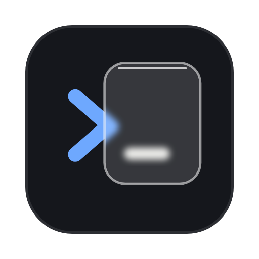
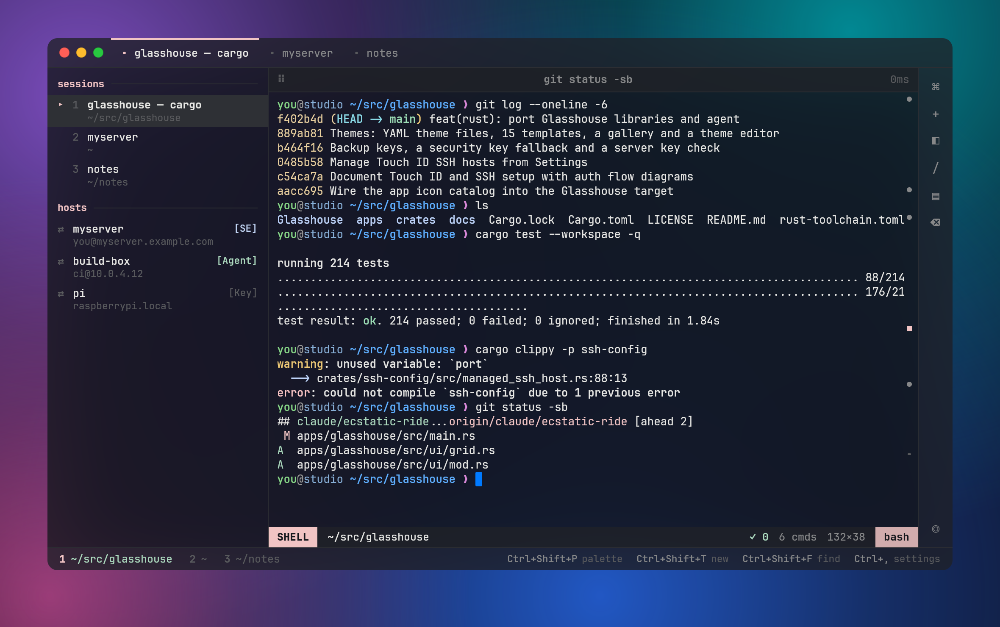
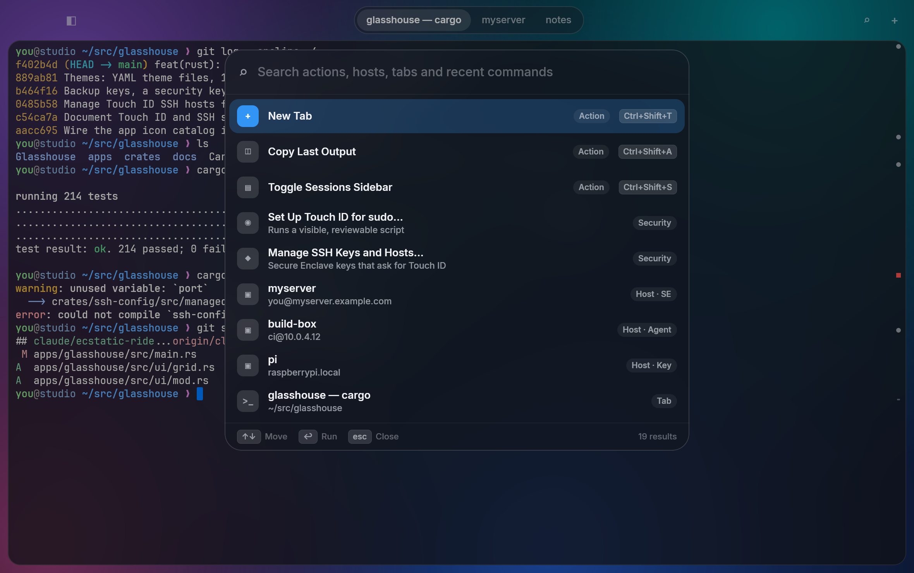
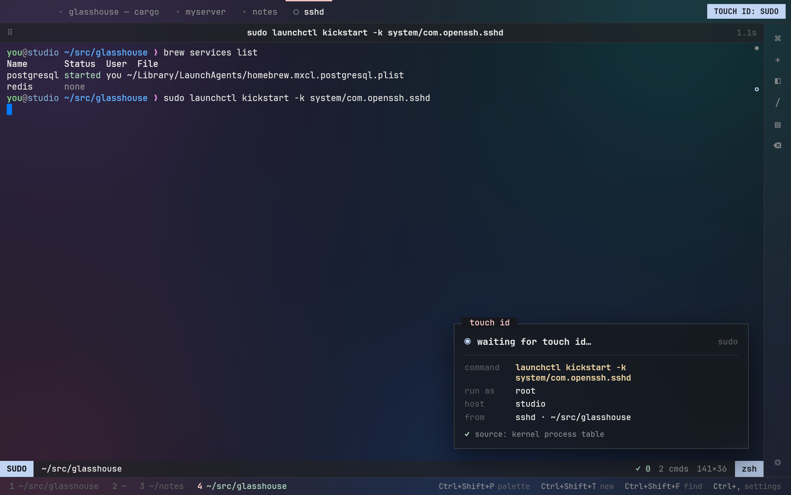
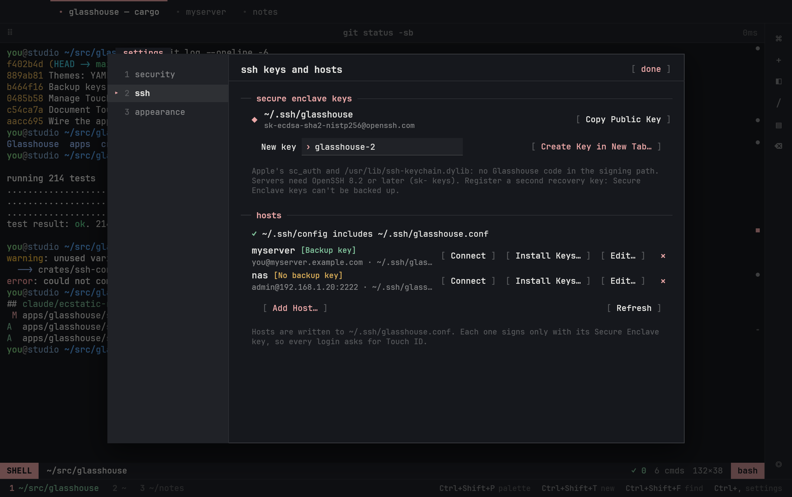
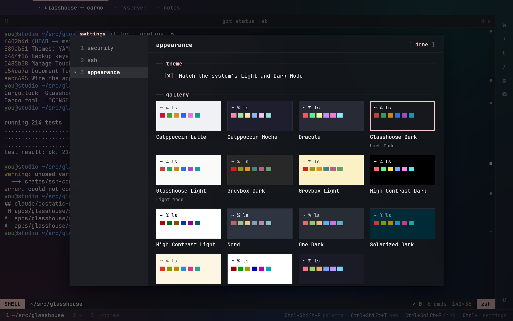
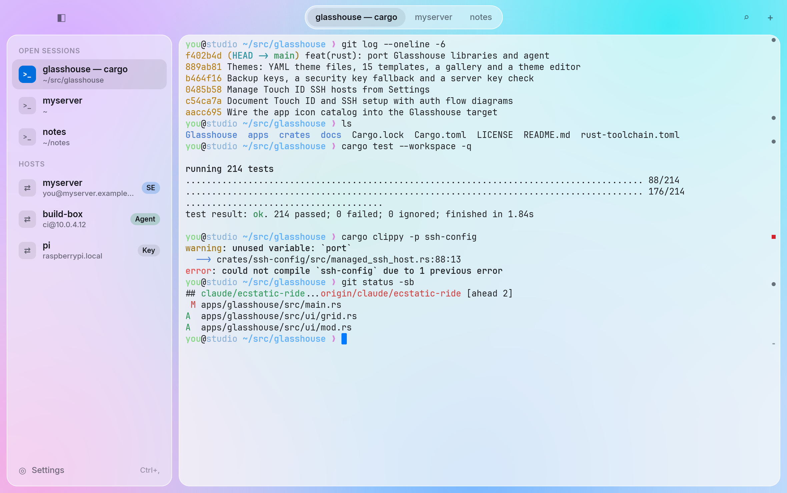
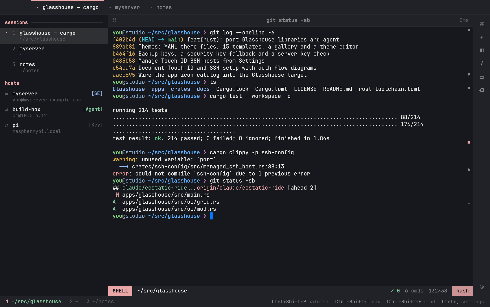

<p align="center">
  
</p>

<h1 align="center">Glasshouse</h1>

<p align="center">
  A terminal drawn on its own character grid, in frosted glass, whose trust signals come from the kernel.<br/>
  Rust, rendered with <a href="https://github.com/anomalyco/rune">Rune</a>. Ported from the Swift app in <code>Glasshouse/</code>.
</p>

<p align="center">
  
</p>

## The view

The whole window is drawn the way a TUI draws itself: one monospace font, the terminal theme's
colours for the chrome, 1 px rules and square corners. Below 100% window opacity the frame is
glass: on macOS the window sits on the system's Liquid Glass (`NSGlassEffectView`, macOS 26), so
the desktop behind it blurs through every surface, tinted by the theme. On other platforms the
desktop shows through unblurred where the compositor allows a transparent window. The screenshots
are rendered headless, with no desktop behind them, so they show a painted wallpaper instead.

| | |
| --- | --- |
| **Tabs and title row**: `• name` per tab, an accent bar over the active one, a spinner while a command runs | **Trust block**: `TOUCH ID: SUDO`, `PASSWORD PROMPT` or `REMOTE: host`, from the kernel's process table, never from program output |
| **Pane header**: the last command and how long it took | **Status line**: `SHELL` / `SSH` / `SUDO` / `SECRET`, the directory, the last exit code, the grid size |
| **Sidebar**: open sessions and the hosts in `~/.ssh/config`, with how each one signs in | **Gutter**: a mark per command, by status (● ran, ■ failed, ○ running) |
| **Hint bar**: numbered tabs (⌘1–9) and the keys worth knowing | **Rail**: palette, new tab, sidebar, find, copy last output, clear, settings |

| Command palette | Touch ID approval card |
| --- | --- |
|  |  |
| **Settings: SSH keys and hosts** | **Settings: Appearance** |
|  |  |
| **Light Mode** | **Opaque (100% opacity)** |
|  |  |

```sh
cargo run -p glasshouse                 # a live shell
cargo run -p glasshouse -- --demo       # scripted tabs, no shell
```

More in [`apps/glasshouse/README.md`](apps/glasshouse/README.md): scenes, screenshots and the code layout.

### Releases

Pushing a `v*` tag runs [`release.yml`](.github/workflows/release.yml), which publishes a GitHub
release with:

- `Glasshouse-<version>-macos-universal.dmg` / `.zip`: `Glasshouse.app` for Apple silicon and Intel,
  with the app icon and the Glasshouse Agent inside (ad-hoc signed, so the first launch needs
  right-click → Open)
- `glasshouse-<version>-linux-<arch>.tar.gz` for x86_64 and aarch64: the binaries, a `.desktop`
  entry and the icon at every hicolor size, laid out as a `/usr/local` prefix

```sh
git tag v0.1.0 && git push origin v0.1.0
scripts/package-macos.sh     # or build the same archives locally, into dist/
scripts/package-linux.sh
```

The icon is [`docs/icon.png`](docs/icon.png) (`AppIconC`), turned into `AppIcon.icns` for the bundle
and also set at runtime, so `cargo run` shows it in the Dock.

---

## Repository template

GitHub repo template setup for all git-repos

## Included CI Checks

The default GitHub Actions workflow in `.github/workflows/ci.yml` runs:

- YAML validation for `.yml` and `.yaml` files (via PyYAML)
- Basic secret-pattern scanning across YAML/JSON sources while excluding common generated/vendor paths

## What are Agent Skills?

Agent Skills are a lightweight, open format for extending AI agent capabilities with specialized knowledge and workflows.

At its core, a skill is a folder containing a `SKILL.md` file. This file includes metadata (`name` and `description`, at minimum) and instructions that tell an agent how to perform a specific task. Skills can also bundle scripts, reference materials, templates, and other resources.

```text
my-skill/
├── SKILL.md          # Required: metadata + instructions
├── scripts/          # Optional: executable code
├── references/       # Optional: documentation
├── assets/           # Optional: templates, resources
└── ...               # Any additional files or directories
```

## Why Agent Skills?

Agents are increasingly capable, but often don't have the context they need to do real work reliably. Skills solve this by packaging procedural knowledge and company-, team-, and user-specific context into portable, version-controlled folders that agents load on demand. This gives agents:

* **Domain expertise**: Capture specialized knowledge — from legal review processes to data analysis pipelines to presentation formatting — as reusable instructions and resources.
* **Repeatable workflows**: Turn multi-step tasks into consistent, auditable procedures.
* **Cross-product reuse**: Build a skill once and use it across any skills-compatible agent.

## How do Agent Skills work?

Agents load skills through **progressive disclosure**, in three stages:

1. **Discovery**: At startup, agents load only the name and description of each available skill, just enough to know when it might be relevant.

2. **Activation**: When a task matches a skill's description, the agent reads the full `SKILL.md` instructions into context.

3. **Execution**: The agent follows the instructions, optionally executing bundled code or loading referenced files as needed.

Full instructions load only when a task calls for them, so agents can keep many skills on hand with only a small context footprint.

## Modifying Template Repo

The standard approach for template repos is a GitHub Actions setup workflow that triggers on the first push to the default branch, skips if running in the template repo itself, performs the substitutions, commits the result, then deletes itself.

The flow:

1. New repo created from template → GitHub creates an initial commit
2. The bundled [setup.yml](.github/workflows/setup.yml) workflow fires on that push
3. It detects it's not the template repo (via github.repository check)
   1. Trigger: `push` to `main` — GitHub fires this automatically when the new repo receives its first commit after being created from the template.
   2. Guard (`if: github.repository != 'jasonkolodziej/git-repo-template'`): prevents the workflow from running inside the template repo itself on every push.
4. Replaces the `# git-repo-template` header (and any other placeholders) with the actual repo name
5. Commits back and self-deletes so it never runs again.
   1. **Self-deletion:** after committing the substitutions, the workflow git rms itself and pushes — so it never runs again in the child repo. The child repo's CI (ci.yml) takes over from that point.
   2. **Extending it:** add more `sed` / `find` lines in the Replace template placeholders step for any other tokens you want to swap out (e.g., owner name, year, license holder).
