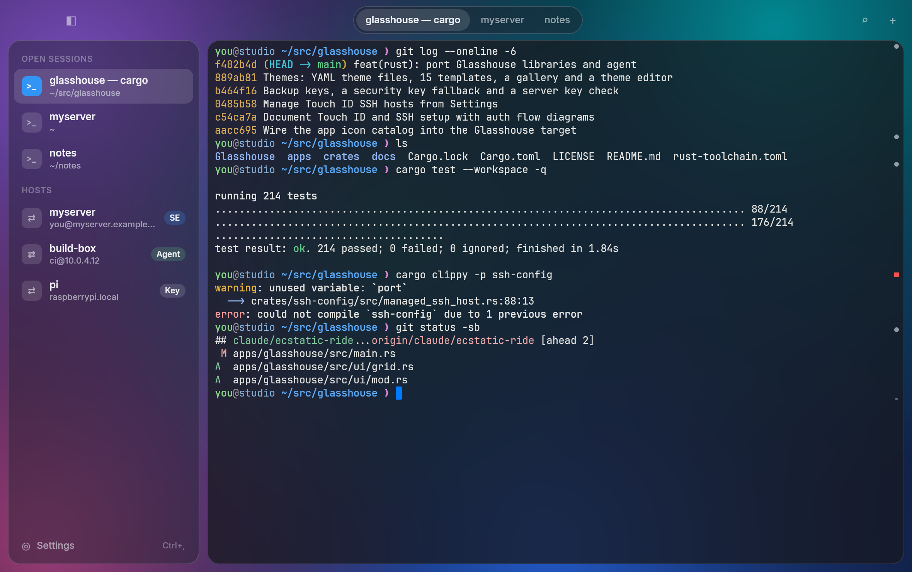
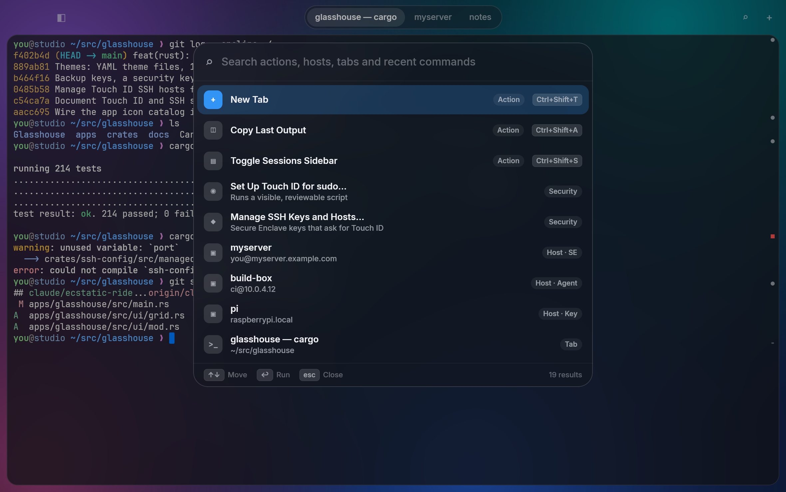
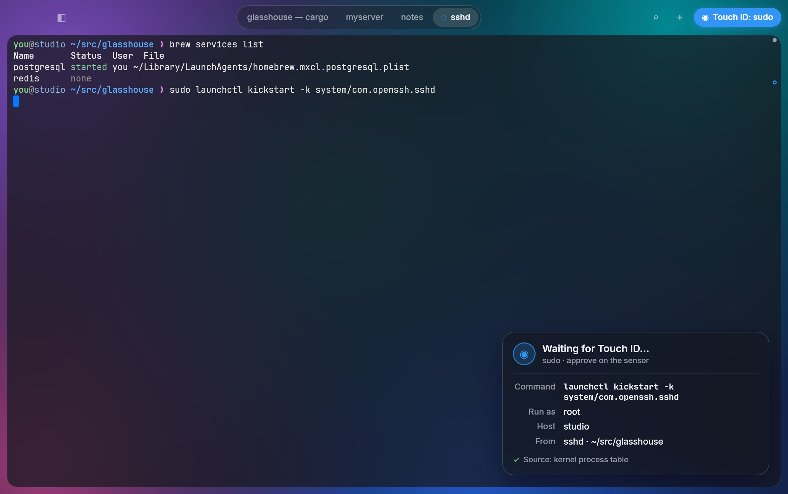
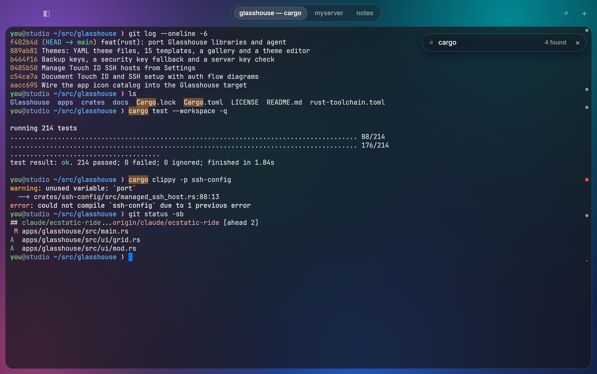
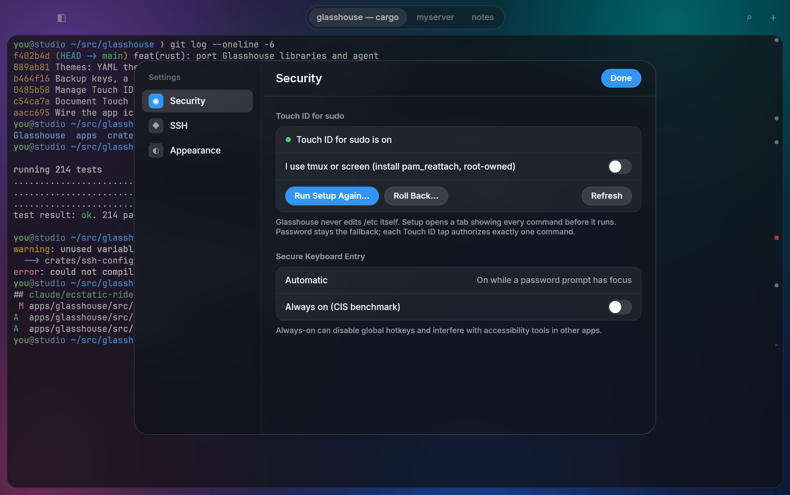
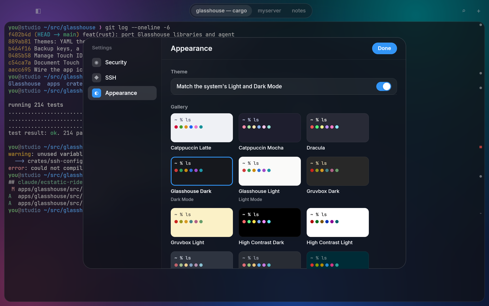

# Glasshouse (Rust + Rune)

The Swift app in `Glasshouse/`, ported to Rust with the [Rune](https://github.com/anomalyco/rune)
UI framework. The chrome is frosted glass: `El::backdrop_blur` under a translucent tint, as in
Rune's `frosted-bar`, `glass-card` and `glass-panel` examples. The terminal pane is the theme's
background at the window opacity over the same blur.

| Terminal | Sidebar |
| --- | --- |
|  |  |
| **Command palette** | **Touch ID approval card** |
|  |  |
| **Find** | **Light Mode** |
|  |  |
| **Settings: Security** | **Settings: SSH** |
|  |  |
| **Settings: Appearance** | |
|  | |

## Run

```sh
cargo run -p glasshouse                 # a live shell
cargo run -p glasshouse -- --demo       # scripted tabs, no shell
```

Linux needs `libxkbcommon-dev` to link.

## Screenshots

Every screenshot is a headless render of a scene. A scene fills the window with demo tabs: real
terminal engines fed recorded output, so no shell is spawned. The scenes are `terminal`,
`sidebar`, `palette`, `approval`, `find`, `settings`, `ssh`, `appearance` and `light`.

```sh
cargo run -p glasshouse -- --snap docs/screenshots/palette.png --scene palette --scale 2 --theme dark
```

Without a GPU, install Mesa's software Vulkan (`mesa-vulkan-drivers`).

## Layout

- `src/ui/mod.rs`: the window, wallpaper, toolbar, tab strip, trust capsule and sidebar
- `src/ui/grid.rs`: the terminal pane, drawn with Rune's `grid` element, plus the cursor, find highlights and command gutter
- `src/ui/overlays.rs`: the command palette, approval card and find bar
- `src/ui/settings.rs`: the Settings sheet
- `src/demo.rs`: scenes for snapshots and `--demo`
