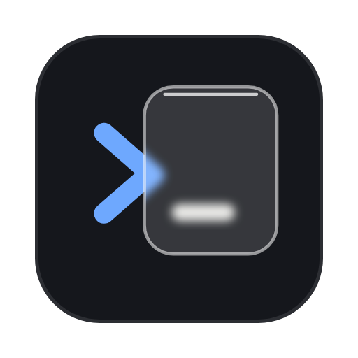
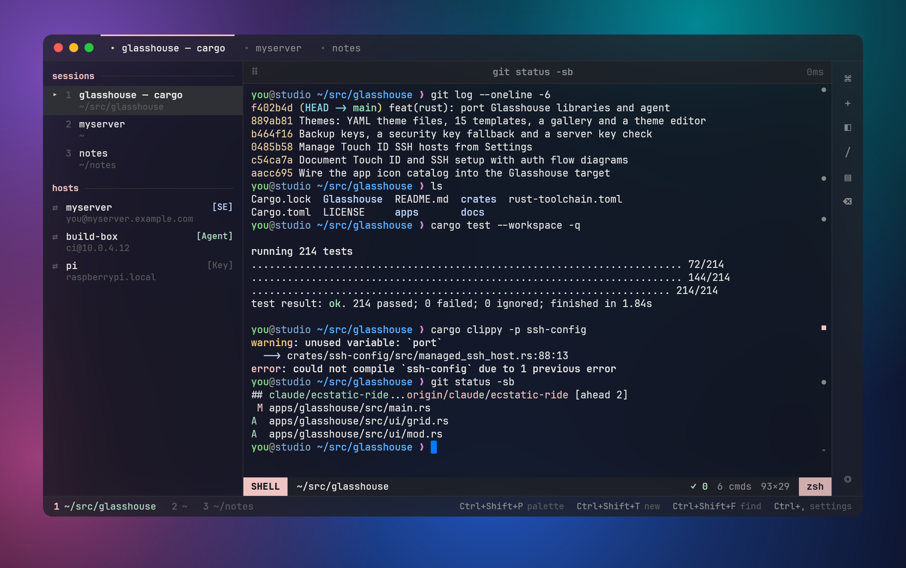
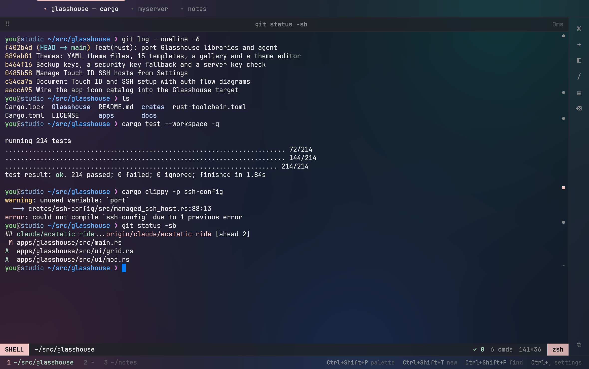
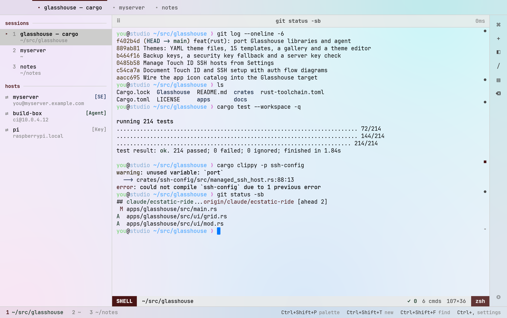
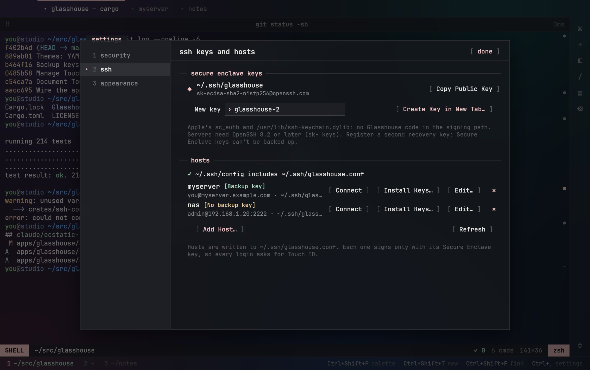
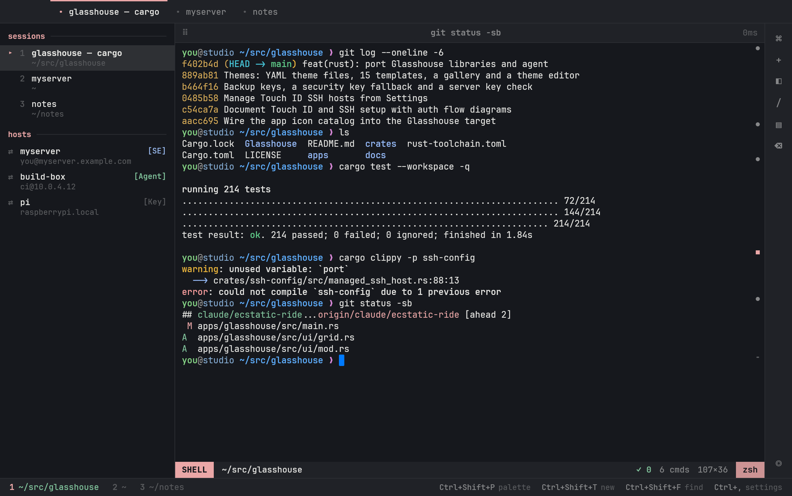

<p align="center"></p>

# Glasshouse (Rust + Rune)



The Swift app in `Glasshouse/`, ported to Rust with the [Rune](https://github.com/anomalyco/rune)
UI framework. The window is drawn the way a TUI draws itself, after the character-grid IDE at
[rune.build](https://rune.build):

- one monospace font for everything, with chrome colours taken from the terminal theme
- 1 px rules instead of cards, and square corners
- `• tab` entries in the title row, with an accent bar over the active one
- a pane header showing the last command and how long it took
- a vim-style status line (`SHELL` / `SSH` / `SUDO` / `SECRET`, coloured by trust)
- a numbered tab bar with key hints along the bottom, and an icon rail down the right
- palette, approval card and Settings as boxes titled in their top rule, with `[x]`, `(•)` and `[ buttons ]`

Below 100% window opacity (Settings → Appearance) the frame is frosted glass: one full-window
`El::backdrop_blur` (as in Rune's `frosted-bar` example) under translucent theme colours, leaving
the other blur slots for the palette, approval card and Settings. The scenes use 74%; `solid`
shows 100%.

| Terminal | Sidebar |
| --- | --- |
|  |  |
| **Command palette** | **Touch ID approval card** |
|  |  |
| **Find** | **Light Mode** |
|  |  |
| **Settings: Security** | **Settings: SSH** |
|  |  |
| **Settings: Appearance** | **Opaque (100% opacity)** |
|  |  |

## Run

```sh
cargo run -p glasshouse                 # a live shell
cargo run -p glasshouse -- --demo       # scripted tabs, no shell
```

Linux needs `libxkbcommon-dev` to link.

## Screenshots

Every screenshot is a headless render of a scene. A scene fills the window with demo tabs: real
terminal engines fed recorded output, so no shell is spawned. The scenes are `terminal`,
`sidebar`, `palette`, `approval`, `find`, `settings`, `ssh`, `appearance`, `light`, `solid` and `hero` (the window floating on the wallpaper, for this README).

```sh
cargo run -p glasshouse -- --snap docs/screenshots/palette.png --scene palette --scale 2 --theme dark --at 0.5
```

`--at 0.5` takes the picture half a second into the scene, after the grid has resized to the pane.
Without a GPU, install Mesa's software Vulkan (`mesa-vulkan-drivers`).

## Layout

- `src/ui/mod.rs`: the window: title row, trust block, sidebar, icon rail, hint bar and theme-derived colours
- `src/ui/grid.rs`: the pane: header, Rune's `grid` element, cursor, find highlights, command gutter and status line
- `src/ui/overlays.rs`: the command palette, approval card and find bar
- `src/ui/settings.rs`: the Settings sheet
- `src/demo.rs`: scenes for snapshots and `--demo`
